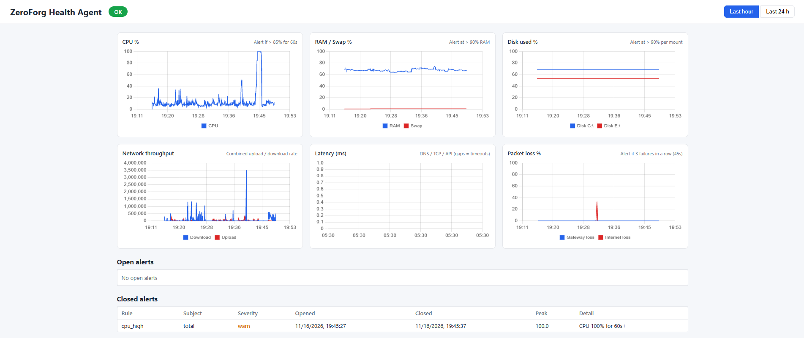
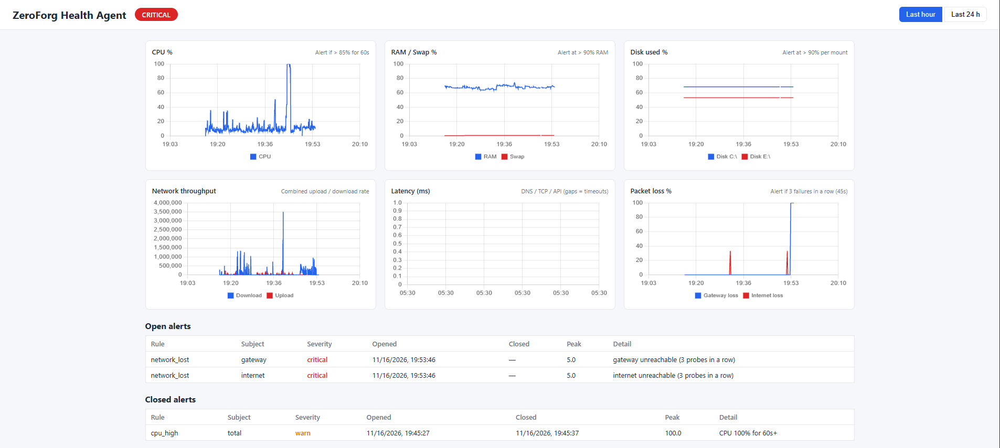
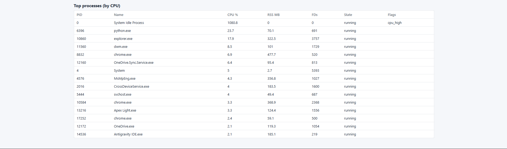

# ZeroForg Edge Health Agent

A lightweight single-process Python health agent designed for remote edge devices (warehouse/factory camera AI boxes). It periodically samples system health, runs network probes, raises deterministic alerts with hysteresis, and serves a live HTTP API + web dashboard.

---

## Dashboard Preview

### System Normal (`OK`)


### Alert State (`CRITICAL`)


### Top Process Monitoring


---

## Quick Start

### 1. Installation
```bash
python -m venv .venv
pip install -r requirements.txt
```

### 2. Run the Agent
```bash
uvicorn app.main:app --host 0.0.0.0 --port 8000
```
* **Dashboard:** http://localhost:8000/
* **API Docs:** http://localhost:8000/docs

### 3. Run Tests
```bash
python -m pytest -q
```

---

## Features

* **System & Process Sampler (every 5s):**
  * Per-core CPU, Total CPU, RAM, Swap, Mount-level Disk %, Disk I/O rates, Network bandwidth rates (handles counter resets cleanly).
  * Monitored process table with CPU, RAM, FDs, and zombie state flags.
* **Network Prober (every 15s):**
  * DNS resolution time, TCP connect time, ping loss to gateway and internet, and target API status.
  * Async/thread-isolated with hard timeouts (hung probes never stall sampler).
* **Alert Engine (SQLite):**
  * Opens once, records peak value, and closes when cleared (no flapping / hysteresis).
  * Auto-prunes metrics older than 7 days.

---

## Alert Rules

| Rule | Trigger Condition | Clear Condition |
| :--- | :--- | :--- |
| **CPU High** | Total CPU > 85% for continuous 60s | < 80% |
| **RAM High** | RAM usage > 90% | < 87% |
| **Disk High** | Any mounted disk > 90% | < 87% |
| **Network Lost** | 3 consecutive probe failures to gateway/internet | 1 successful probe |
| **Process Died** | Monitored process (from `config.json`) exits | Process runs again |
| **Memory Climbing** | Process RSS steadily grows by ≥ 50 MB | Leak stops |
| **Zombie** | Process remains in state `Z` for > 30s | Zombie reaped |

---

## API Endpoints

* `GET /health` – System status badge (`ok` / `warn` / `critical`) & active alerts.
* `GET /metrics?name=cpu_total&since=1h` – Historical metric timeseries.
* `GET /alerts?open=true` – Open and closed alerts with timestamps and peak values.
* `GET /processes?sort=cpu` – Real-time snapshot of top running processes.

---
